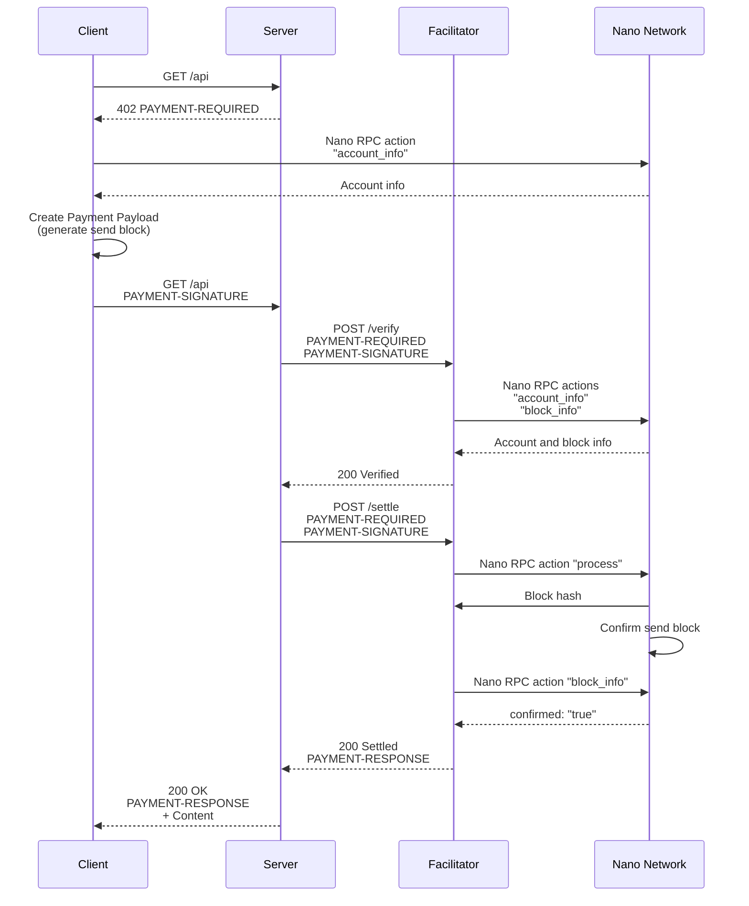

# Scheme: `exact` on `Nano`

## x402 Versions Supported

- ✅ v2

## Supported Networks

- `nano:mainnet` — Nano mainnet (Main network)
- `nano:*` — Any other Nano network

## Summary

The `exact` scheme on Nano uses send blocks for fixed-amount payments. The **`Client`** creates a [send block] based on the **`Resource Server`**'s payment requirement. The **`Facilitator`** verifies and settles this send block on the network. No fee calculation is required as Nano is a feeless network. Settlement typically takes about half a second.

## Protocol Flow

The high-level flow for the `exact` scheme is as follows:

1. **`Client`** sends an HTTP request to the **`Resource Server`** for a resource.
2. **`Resource Server`** responds with a `402 Payment Required` status, including `PaymentRequirements` in a `PAYMENT-REQUIRED` header specifying the `exact` scheme, network, asset `XNO`, account to `payTo`, and `amount` (in [raw units]).
3. **`Client`** constructs and signs a [send block] for the exact amount, and places it inside a `PaymentPayload`. Block construction requires communication with the Nano network to retrieve up-to-date account information.
4. **`Client`** resends the request to **`Resource Server`** with the `PaymentPayload` attached in the `PAYMENT-SIGNATURE` header.
5. **`Resource Server`** forwards the `PaymentPayload` to the **`Facilitator`** for verification (`/verify`).
6. **`Facilitator`** verifies the `PaymentPayload` by querying the Nano network to retrieve up-to-date account and block information.
7. Upon verification, the **`Resource Server`** forwards the `PaymentPayload` to the **`Facilitator`** for settlement (`/settle`).
8. **`Facilitator`** processes the send block contained in the `PaymentPayload` and broadcasts it to the Nano network for confirmation.
9. **`Facilitator`** polls the network for block confirmation.
10. Upon block confirmation (settlement), **`Facilitator`** communicates the confirmation hash back to the **`Resource Server`** in the `PAYMENT-RESPONSE` header.
11. **`Resource Server`** delivers the paid resource to the **`Client`** along with `PAYMENT-RESPONSE` header.



## `PaymentRequirements` for `exact`

This payment requirement appears inside the `accepts` array of a `PaymentRequired` object carried in the `PAYMENT-REQUIRED` header.

```json
{
  "scheme": "exact",
  "network": "nano:mainnet",
  "asset": "XNO",
  "amount": "10000000000000000000000000000",
  "payTo": "nano_3ah94brzdm3e5nzzpstzcyxgkddt3ydgzi4478jshawrh7gtof5sb8twxqxt",
  "maxTimeoutSeconds": 120
}
```

- `scheme`: Always `exact` for this scheme.
- `network`: CAIP-2 network identifier, e.g. `nano:mainnet` (Nano mainnet)
- `asset`: This value MUST always be `XNO` as the payment is in native Nano currency. XNO is the ticker for Nano currency.
- `amount`: The amount MUST be expressed in [raw units] (1 nano unit = 10^30 raw units). For example 10000000000000000000000000000 raw units = 0.01 nano units.
- `payTo`: The Nano account that will be receiving the payment. Nano accounts are prefixed with `nano_`.
- `maxTimeoutSeconds`: The maximum number of seconds the **`Facilitator`** SHOULD check for confirmation of the send block on the Nano network.

No additional `extra` fields are required.

## `PaymentPayload` for `exact` (`PAYMENT-SIGNATURE` Header)

**`Client`** includes `PaymentPayload` inside a base64-encoded `PAYMENT-SIGNATURE` header:

```json
{
  "x402Version": 2,
  "resource": {
    "url": "https://example.com/api/data",
    "description": "Access to protected API endpoint",
    "mimeType": "application/json"
  },
  "accepted": {
    "scheme": "exact",
    "network": "nano:mainnet",
    "asset": "XNO",
    "amount": "10000000000000000000000000000",
    "payTo": "nano_3ah94brzdm3e5nzzpstzcyxgkddt3ydgzi4478jshawrh7gtof5sb8twxqxt",
    "maxTimeoutSeconds": 120
  },
  "payload": {
    "block": {
      "type": "state",
      "account": "nano_3qgmh14nwztqw4wmcdzy4xpqeejey68chx6nciczwn9abji7ihhum9qtpmdr",
      "previous": "F47B23107E5F34B2CE06F562B5C435DF72A533251CB414C51B2B62A8F63A00E4",
      "representative": "nano_1hza3f7wiiqa7ig3jczyxj5yo86yegcmqk3criaz838j91sxcckpfhbhhra1",
      "balance": "20000000000000000000000000000",
      "link": "19D3D919475DEED4696B5D13018151D1AF88B2BD3BCFF048B45031C1F36D1858",
      "link_as_account": "nano_3ah94brzdm3e5nzzpstzcyxgkddt3ydgzi4478jshawrh7gtof5sb8twxqxt",
      "signature": "3BFBA64A775550E6D49DF1EB8EEC2136DCD74F....77FFF15FD11E6E2162A1714731B743D1E941FA4560A",
      "work": "ffffffd2e1234567"
    }
  },
  "extensions": {}
}
```

`PaymentPayload.payload` in the `PAYMENT-SIGNATURE` header must follow the following schema:

- `block`: The full contents of the [send block] which authorizes the transfer of [raw units] on the Nano network. During creation of the send block, the **`Client`** MUST use Nano RPC action [account_info] to request the account information it needs to construct the block. Additionally `PaymentPayload.payload.block.work`, the required Proof-of-Work for anti-spam purposes on the Nano network, MUST be generated using `PaymentPayload.payload.block.previous` as input. The `representative` field returned by Nano RPC action [account_info] (call with `representative` parameter set to `true`) SHOULD be used during creation of the send block to avoid re-delegation of the voting weight for the **`Client`**'s Nano account.

## Verification

For the **`Facilitator`** to verify a payment in the `exact` scheme, these checks MUST be carried out in the following order:

1. **x402 Version Check** - `PaymentPayload.x402Version` MUST be equal to any of the **`Facilitator`**'s supported x402 versions.
2. **Scheme Check** - `PaymentPayload.accepted.scheme` and `PaymentRequirements.scheme` MUST have the value `exact`.
3. **Network Supported Check** - `PaymentPayload.accepted.network` and `PaymentRequirements.network` MUST be prefixed with `nano:`.
4. **Network Mismatch Check** - `PaymentPayload.accepted.network` and `PaymentRequirements.network` MUST be equal.
5. **Asset Check** - `PaymentPayload.accepted.asset` and `PaymentRequirements.asset` MUST have the value `XNO`.
6. **Block Structure Check** - `PaymentPayload.payload.block`'s structure MUST match that of a Nano [send block].
7. **Valid Signature Check** - `PaymentPayload.payload.block.signature` MUST be a valid signature for `PaymentPayload.payload.block`.
8. **Valid Block Check** - `PaymentPayload.payload.block` MUST be validated by decoding `PaymentPayload.payload.block.account` into its 32-byte public key, computing the hash of the block (incorporating the `account`, `previous`, `representative`, `balance`, and `link` fields found inside `PaymentPayload.payload.block`), and verifying `PaymentPayload.payload.block.signature` against that hash and public key.
9. **payTo Check** - `PaymentPayload.payload.block.link_as_account` MUST exactly match `PaymentPayload.accepted.payTo`. `PaymentPayload.payload.block.link_as_account` MUST also be the correct Nano account encoding of the 32-byte public key in `PaymentPayload.payload.block.link`.
10. **Previous Confirmation Check** - **`Facilitator`** MUST verify that `PaymentPayload.payload.block` does not already exist on the Nano network. Use Nano RPC action [block_info], passing the calculated hash of `PaymentPayload.payload.block` as a parameter, to check for existence of this block. If [block_info] finds the block, parse the response and return `error_block_already_confirmed` when field `confirmed` is `true` and `error_block_awaiting_confirmation` when field `confirmed` is `false`. This check also provides fork protection (see **Fork protection** in **Appendix** later in this document).
11. **Account Check** - `PaymentPayload.payload.block.account` MUST exist on the Nano network. Use Nano RPC action [account_info] to query information for `PaymentPayload.payload.block.account` and ensure that the response has a `frontier` field.
12. **Frontier Hash Check** - `PaymentPayload.payload.block.previous` MUST exactly match frontier hash for `PaymentPayload.payload.block.account`. Use Nano RPC action [account_info] (call with `include_confirmed` parameter set to `true`) to query information for `PaymentPayload.payload.block.account` and check that the `confirmed_frontier` field in the response is equal to `PaymentPayload.payload.block.previous`.
13. **Balance Check** - `PaymentPayload.payload.block.account` MUST have balance to cover payment. Use Nano RPC action [account_info] to query information for `PaymentPayload.payload.block.account` and ensure that the delta between the `balance` field (_previous_balance_) returned in the response and `PaymentPayload.payload.block.balance` (_new_balance_) is equal to `PaymentPayload.accepted.amount` (_payment_amount_). Calculation is _previous_balance_ - _new_balance_ = _payment_amount_.
14. **Work Difficulty Check** - `PaymentPayload.payload.block.work` MUST be validated to ensure it meets the Nano network's current minimum difficulty threshold for a send transaction.

## Settlement

The **`Facilitator`** determines Settlement using a two-step approach:

1. **Broadcast Step** - Before broadcasting, **`Facilitator`** MUST re-verify against the full set of Verification checks. Any check that fails MUST produce an Unsuccessful Settlement Response containing the corresponding `errorReason`. If re-verification is successful then **`Facilitator`** broadcasts `PaymentPayload.payload.block` to the Nano network with the Nano RPC action [process] (the `subtype` parameter MUST be set to `send`) and notes the returned hash of the broadcasted block.

2. **Confirmed Step** - **`Facilitator`** polls the network for confirmation of the broadcasted block's hash using Nano node RPC action [block_info]. Check that the field `confirmed` is `true` in its response to determine if the block is confirmed. Polling SHOULD occur at one second intervals, up to a maximum of `PaymentRequirements.maxTimeoutSeconds`.

`Broadcasted` means that **`Facilitator`** has checked the validity of the block and broadcasted the block to the Nano network. The block is not yet confirmed.

`Confirmed` means that the block has successfully gathered enough votes from Nano network representatives to reach quorum and has achieved absolute, irreversible finality.

It is recommended that the **`Facilitator`** SHOULD wait half a second before initial polling for block confirmation using Nano node RPC action [block_info]. A typical Nano block confirms in about half a second so this small wait should reduce the need for additional polling and provides an improved payment experience for the **`Client`**.

It is possible that the **`Client`** adds a block to their Nano account (like an auto-receive block or another concurrent payment) between the Verification and Settlement stages of an ongoing payment attempt. This will result in an unsuccessful Settlement because the **`Client`**'s Nano account now has a different frontier hash to the one that MUST exactly match `PaymentPayload.payload.block.previous` (see **Frontier Hash Check** in Verification). If this happens the **`Facilitator`** MUST return an `errorReason` of `error_previous_not_frontier` (see **Error Vocabulary**) so that the **`Client`** understands that it needs to construct a new [send block] and not attempt to resubmit the now outdated send block.

### Successful Settlement Response

A successful `SettlementResponse` for the `exact` scheme:

```json
{
  "success": true,
  "payer": "nano_3qgmh14nwztqw4wmcdzy4xpqeejey68chx6nciczwn9abji7ihhum9qtpmdr",
  "transaction": "0DF7EC8E0955E2A242E3C68B36CBDD639FBB56914AF63AE87295F17D30D9C9D4",
  "network": "nano:mainnet"
}
```

Field Descriptions:

- `payer`: The **`Client`**'s Nano account that signed the send block.
- `transaction`: Confirmation hash of the send block.

The **`Resource Server`** base64-encodes the Settlement Response and sends it to **`Client`** in a `PAYMENT-RESPONSE` header:

```json
HTTP/1.1 200 OK
Content-Type: application/json
PAYMENT-RESPONSE: eyJzdWNjZXNzI.....I2NiJ9

{
  "data": "paid resource response data",
  "timestamp": "2026-08-26T10:30:00Z"
}
```

### Unsuccessful Settlement Response

```json
{
  "success": false,
  "errorReason": "error_block_already_confirmed",
  "payer": "nano_3qgmh14nwztqw4wmcdzy4xpqeejey68chx6nciczwn9abji7ihhum9qtpmdr",
  "transaction": "0DF7EC8E0955E2A242E3C68B36CBDD639FBB56914AF63AE87295F17D30D9C9D4",
  "network": "nano:mainnet"
}
```

If a Settlement fails due to the [send block] already being broadcast or confirmed on the Nano network, the **`Facilitator`** MUST fill `transaction` in the Unsuccessful Settlement Response with the block hash of `PaymentPayload.payload.block` (see **When is a payment considered fulfilled?** in **Appendix** later in this document). By doing so a **`Resource Server`** whose first successful settlement reply was lost can learn if the `PaymentPayload.payload.block` was previously broadcast or confirmed without broadcasting it again (see **Blocks have no expiry** in **Appendix** later in this document).

## Error Vocabulary

**`Facilitator`** MUST use the following error codes across both `invalidReason` (Verification failure) and `errorReason` (Settlement failure) to describe errors encountered.

| Error Code                          | Meaning                                                                                                                                                          | Used In                                                                                           |
| ----------------------------------- | ---------------------------------------------------------------------------------------------------------------------------------------------------------------- | ------------------------------------------------------------------------------------------------- |
| `error_x402_version_not_supported`  | `PaymentPayload.x402Version` is not supported                                                                                                                    | x402 Version Check, Unsuccessful Settlement Response                                              |
| `error_unsupported_scheme`          | `PaymentPayload.accepted.scheme` and/or `PaymentRequirements.scheme` do not have the value `exact`                                                               | Scheme Check, Unsuccessful Settlement Response                                                    |
| `error_unsupported_network`         | `PaymentPayload.accepted.network` and/or `PaymentRequirements.network` are unsupported                                                                           | Network Supported Check, Unsuccessful Settlement Response                                         |
| `error_network_mismatch`            | `PaymentPayload.accepted.network` differs from `PaymentRequirements.network`                                                                                     | Network Mismatch Check, Unsuccessful Settlement Response                                          |
| `error_invalid_asset`               | `PaymentPayload.accepted.asset` and/or `PaymentRequirements.asset` do not have the value `XNO`                                                                   | Asset Check, Unsuccessful Settlement Response                                                     |
| `error_invalid_signature`           | `PaymentPayload.payload.block.signature` is not a valid signature for `PaymentPayload.payload.block`                                                             | Valid Signature Check, Unsuccessful Settlement Response                                           |
| `error_invalid_block`               | `PaymentPayload.payload.block` is not a valid Nano send block                                                                                                    | Block Structure Check, Valid Block Check, Unsuccessful Settlement Response                        |
| `error_payto_link_mismatch`         | `PaymentPayload.payload.block.link_as_account` differs from `PaymentPayload.accepted.payTo`                                                                      | payTo Check, Unsuccessful Settlement Response                                                     |
| `error_account_not_found`           | `PaymentPayload.payload.block.account` not found on the Nano network                                                                                             | Account Check, Unsuccessful Settlement Response                                                   |
| `error_previous_not_frontier`       | `PaymentPayload.payload.block.previous` does not match `confirmed_frontier` for `PaymentPayload.payload.block.account`                                           | Frontier Hash Check, Unsuccessful Settlement Response                                             |
| `error_not_enough_balance`          | Balance for `PaymentPayload.payload.block.account` is not enough to cover `PaymentPayload.accepted.amount`                                                       | Balance Check, Unsuccessful Settlement Response                                                   |
| `error_amount_mismatch`             | Delta between the balance for `PaymentPayload.payload.block.account` and `PaymentPayload.payload.block.balance` is not equal to `PaymentPayload.accepted.amount` | Balance Check, Unsuccessful Settlement Response                                                   |
| `error_invalid_work`                | `PaymentPayload.payload.block.work` is invalid                                                                                                                   | Work Difficulty Check, Unsuccessful Settlement Response                                           |
| `error_timeout_expired`             | `PaymentRequirements.maxTimeoutSeconds` has expired                                                                                                              | Unsuccessful Settlement Response                                                                  |
| `error_block_already_confirmed`     | `PaymentPayload.payload.block` is already confirmed on the Nano network                                                                                          | Previous Confirmation Check, Unsuccessful Settlement Response                                     |
| `error_block_awaiting_confirmation` | `PaymentPayload.payload.block` has been broadcast to the Nano network and is awaiting confirmation                                                               | Previous Confirmation Check, Unsuccessful Settlement Response                                     |
| `error_block_not_broadcast`         | `PaymentPayload.payload.block` unable to be broadcast to the Nano network                                                                                        | Unsuccessful Settlement Response                                                                  |
| `error_nano_rpc`                    | Nano RPC failure                                                                                                                                                 | Previous Confirmation Check, Account Check, Frontier Hash Check, Unsuccessful Settlement Response |

## Nano RPC examples

### [account_info] action

Returns information for an account on the Nano network. Specify the Nano account with `account`. Make sure both `include_confirmed` and `representative` are set to `true`.

```
{
  "action": "account_info",
  "account": "nano_3qgmh14nwztqw4wmcdzy4xpqeejey68chx6nciczwn9abji7ihhum9qtpmdr",
  "include_confirmed": "true",
  "representative": "true"
}
```

Used by: **`Client`**, **`Facilitator`**

### [block_info] action

Returns information for a block on the Nano network. Specify the block by passing its block hash into `hash`.

```
{
  "action": "block_info",
  "hash": "1D562FA09DD3D6E99AE41B065861A36930456BE907002BD8F93220DB0FE3995F",
  "json_block": "true"
}
```

Used by: **`Facilitator`**

### [process] action (for a send block)

Broadcasts a [send block] to the Nano network. Make sure that `subtype` is set to `send`, and that `block` has the same structure as `PaymentPayload.payload.block`.

```
{
  "action": "process",
  "block": {
    "type": "state",
    "account": "nano_3qgmh14nwztqw4wmcdzy4xpqeejey68chx6nciczwn9abji7ihhum9qtpmdr",
    "previous": "F47B23107E5F34B2CE06F562B5C435DF72A533251CB414C51B2B62A8F63A00E4",
    "representative": "nano_1hza3f7wiiqa7ig3jczyxj5yo86yegcmqk3criaz838j91sxcckpfhbhhra1",
    "balance": "20000000000000000000000000000",
    "link": "19D3D919475DEED4696B5D13018151D1AF88B2BD3BCFF048B45031C1F36D1858",
    "link_as_account": "nano_3ah94brzdm3e5nzzpstzcyxgkddt3ydgzi4478jshawrh7gtof5sb8twxqxt",
    "signature": "3BFBA64A775550E6D49DF1EB8EEC2136DCD74F....77FFF15FD11E6E2162A1714731B743D1E941FA4560A",
    "work": "ffffffd2e1234567"
  },
  "subtype": "send",
  "json_block": "true"
}
```

Used by: **`Facilitator`**

## Test Vectors

Generated on 2026-10-01 against a live facilitator (`facilitator.pursekeeper.dev`, Node implementation) and the Nano main network. Every hash below can be checked on any Nano node or block explorer. V1 and V13 are real settled payments; V2 to V12 are `/verify` requests that broadcast nothing. V1 to V12 were generated on 2026-10-01, V13 on 2026-10-14 against the same facilitator after it took up the amount clause of check 10 (Previous Confirmation Check). The payer is an ordinary account funded for this purpose; `payTo` is a seller account. The capture of every request and response as sent and received is at [pursekeeper/api, examples/research/x402-vectors-2026-10-01.json](https://github.com/pursekeeper/api/blob/main/examples/research/x402-vectors-2026-10-01.json) and, for V13, [examples/research/x402-vector-v13-2026-10-14.json](https://github.com/pursekeeper/api/blob/main/examples/research/x402-vector-v13-2026-10-14.json).

The `invalidReason` and `errorReason` values are the ones this facilitator returned when the vectors were cut, before this document's Error Vocabulary existed; the vocabulary code each corresponds to is given beside it. Check numbers follow the Verification section of this document.

### Common inputs

```json
{
  "paymentRequirements": {
    "scheme": "exact",
    "network": "nano:mainnet",
    "asset": "XNO",
    "amount": "1000000000000000000000000000",
    "payTo": "nano_1xug1q5t7nxoj3ywwzokiea9jz8fq8qfgzp8pbyfr3co3e5xgj755uofu8ue",
    "maxTimeoutSeconds": 60
  }
}
```

`payTo` decodes to the public key `776E05C7A2D3B5887DCE7EB2831078FCCDB9AED77EC6B27CDC05550B07D744A3`.

Payer `nano_1i3y944esngqw6wb6ia68dotj4yuqctch9kx8ct65twt8ewi4rdcfgax7ggf`. Nano RPC `account_info` for the payer immediately before V1 (fields not used by the scheme omitted):

```json
{
  "frontier": "DE891E21F480F772E68B61B1C7D8BF6525E5D9FAE64AD5B7BC71F9486348B943",
  "balance": "10787318189447476890320950701",
  "representative": "nano_3arg3asgtigae3xckabaaewkx3bzsh7nwz7jkmjos79ihyaxwphhm6qgjps4",
  "confirmed_frontier": "DE891E21F480F772E68B61B1C7D8BF6525E5D9FAE64AD5B7BC71F9486348B943",
  "confirmed_height": "98",
  "block_count": "98"
}
```

Work was generated against `previous` at the send threshold `fffffff800000000`.

### V0: the seller's 402

`GET https://pursekeeper.dev/v1/echo?msg=vector` without payment answered `402` with a `PAYMENT-REQUIRED` header decoding to a `PaymentRequired` whose `accepts` entry has exactly the six fields above (this seller adds `extra.work: "optional"`, an extension of its own that the vectors do not use).

### V1: valid payment, verified, settled, confirmed

`PaymentPayload` (the decoded `PAYMENT-SIGNATURE` header and the `paymentPayload` field of the `/verify` and `/settle` bodies):

```json
{
  "x402Version": 2,
  "resource": {
    "url": "https://pursekeeper.dev/v1/echo?msg=vector",
    "description": "returns what you sent (test your payment client)",
    "mimeType": "application/json"
  },
  "accepted": {
    "scheme": "exact",
    "network": "nano:mainnet",
    "asset": "XNO",
    "amount": "1000000000000000000000000000",
    "payTo": "nano_1xug1q5t7nxoj3ywwzokiea9jz8fq8qfgzp8pbyfr3co3e5xgj755uofu8ue",
    "maxTimeoutSeconds": 60
  },
  "payload": {
    "block": {
      "type": "state",
      "account": "nano_1i3y944esngqw6wb6ia68dotj4yuqctch9kx8ct65twt8ewi4rdcfgax7ggf",
      "previous": "DE891E21F480F772E68B61B1C7D8BF6525E5D9FAE64AD5B7BC71F9486348B943",
      "representative": "nano_3arg3asgtigae3xckabaaewkx3bzsh7nwz7jkmjos79ihyaxwphhm6qgjps4",
      "balance": "9787318189447476890320950701",
      "link": "776E05C7A2D3B5887DCE7EB2831078FCCDB9AED77EC6B27CDC05550B07D744A3",
      "link_as_account": "nano_1xug1q5t7nxoj3ywwzokiea9jz8fq8qfgzp8pbyfr3co3e5xgj755uofu8ue",
      "signature": "65AFBF7622955A1D6E5E0703B479C33BA652CB4C29477968D2E8864891124875C3EA3F658F597CDB689086F2DE1638BAC0847CFC05CF682682967927D465FB03",
      "work": "3f6ff9e7b7ba27a7"
    }
  }
}
```

Block hash (BLAKE2b-256 over the six state-block fields, the hash the signature covers): `1D60903EFD920FA78746E18F08C021EE7B8155205709DF5A4125BBDCF96D0BEB`.

`POST /verify` with `{ "x402Version": 2, "paymentPayload": <above>, "paymentRequirements": <common inputs> }` answered `200`:

```json
{
  "isValid": true,
  "payer": "nano_1i3y944esngqw6wb6ia68dotj4yuqctch9kx8ct65twt8ewi4rdcfgax7ggf"
}
```

`POST /settle` with the same body answered `200` after 584 ms, which includes the `process` call and the confirmation poll:

```json
{
  "success": true,
  "transaction": "1D60903EFD920FA78746E18F08C021EE7B8155205709DF5A4125BBDCF96D0BEB",
  "network": "nano:mainnet",
  "payer": "nano_1i3y944esngqw6wb6ia68dotj4yuqctch9kx8ct65twt8ewi4rdcfgax7ggf"
}
```

Nano RPC `block_info` for `transaction` afterwards:

```json
{
  "confirmed": "true",
  "height": "99",
  "amount": "1000000000000000000000000000",
  "subtype": "send",
  "block_account": "nano_1i3y944esngqw6wb6ia68dotj4yuqctch9kx8ct65twt8ewi4rdcfgax7ggf"
}
```

### V2: replay of the settled block

The exact V1 body presented again after settlement. `/verify`:

```json
{
  "isValid": false,
  "invalidReason": "block_already_exists",
  "payer": "nano_1i3y944esngqw6wb6ia68dotj4yuqctch9kx8ct65twt8ewi4rdcfgax7ggf"
}
```

`/settle`:

```json
{
  "success": false,
  "errorReason": "block_already_exists",
  "transaction": "1D60903EFD920FA78746E18F08C021EE7B8155205709DF5A4125BBDCF96D0BEB",
  "network": "nano:mainnet",
  "payer": "nano_1i3y944esngqw6wb6ia68dotj4yuqctch9kx8ct65twt8ewi4rdcfgax7ggf"
}
```

The settle refusal still names the original `transaction`, so a resource server whose first success reply was lost can learn that the payment went through without being served twice. This is the behaviour the **Unsuccessful Settlement Response** and **Blocks have no expiry** sections ask for; in the Error Vocabulary the code is `error_block_already_confirmed`, from check 10 (Previous Confirmation Check).

### V3 to V12: refused at verification, nothing broadcast

All are built on the payer's frontier after V1 (`1D60903EFD920FA78746E18F08C021EE7B8155205709DF5A4125BBDCF96D0BEB`, balance `9787318189447476890320950701`) with valid work `feec391ed40f8b85` for that frontier, except V7 (built on the pre-V1 frontier with V1's work) and V11 (a different, never-opened account). Each block is correctly signed by its account unless the row says otherwise, so checks 6 to 9 can be re-run offline from the JSON; checks 10 to 14 depend on the ledger state recorded above and will answer `error_previous_not_frontier` (`frontier_moved` here) once the payer's account moves on.

| Vector | Mutation from a valid block | Verification check that fails | `invalidReason` | Error Vocabulary |
|---|---|---|---|---|
| V3 | signature: last hex character changed | 7 (Valid Signature Check) | `invalid_signature` | `error_invalid_signature` |
| V4 | balance = previous balance − amount + 1 (1 raw short) | 13 (Balance Check) | `amount_mismatch` | `error_amount_mismatch` |
| V5 | balance = previous balance − 2 × amount (twice the amount) | 13 (Balance Check) | `amount_mismatch` | `error_amount_mismatch` |
| V6 | link = public key of another account; link_as_account agrees with link | 9 (payTo Check) | `invalid_payto` | `error_payto_link_mismatch` |
| V7 | previous = the frontier before V1 landed (a fork of V1 with a different balance) | 12 (Frontier Hash Check) | `frontier_moved` | `error_previous_not_frontier` |
| V8 | work = 0000000000000001 | 14 (Work Difficulty Check) | `invalid_work` | `error_invalid_work` |
| V9 | accepted.network = nano:testnet while paymentRequirements.network = nano:mainnet | 4 (Network Mismatch Check) | `requirements_mismatch` | `error_network_mismatch` |
| V10 | x402Version = 1 | 1 (x402 Version Check) | `unsupported_x402_version` | `error_x402_version_not_supported` |
| V11 | payer is an account with no blocks; previous = 64 zeros, balance 0 | 11 (Account Check) | `account_not_found` | `error_account_not_found` |
| V12 | link_as_account names another account while link is payTo's key | 9 (payTo Check) | `invalid_payto` | `error_payto_link_mismatch` |

<details>
<summary>Blocks and responses for V3 to V12</summary>

**V3**: Signature does not verify.

```json
{
  "block": {
    "type": "state",
    "account": "nano_1i3y944esngqw6wb6ia68dotj4yuqctch9kx8ct65twt8ewi4rdcfgax7ggf",
    "previous": "1D60903EFD920FA78746E18F08C021EE7B8155205709DF5A4125BBDCF96D0BEB",
    "representative": "nano_3arg3asgtigae3xckabaaewkx3bzsh7nwz7jkmjos79ihyaxwphhm6qgjps4",
    "balance": "8787318189447476890320950701",
    "link": "776E05C7A2D3B5887DCE7EB2831078FCCDB9AED77EC6B27CDC05550B07D744A3",
    "link_as_account": "nano_1xug1q5t7nxoj3ywwzokiea9jz8fq8qfgzp8pbyfr3co3e5xgj755uofu8ue",
    "signature": "37B0AFA22ACE7F4B7BFBEB49C3DAF84FF6EB32766DD9791027D948E0C422AF98358B923608EA11360C2C8548FCBE94E5D58F6CAF94186E6C39FF36A24B513A00",
    "work": "feec391ed40f8b85"
  },
  "verify_response": {
    "isValid": false,
    "invalidReason": "invalid_signature",
    "payer": "nano_1i3y944esngqw6wb6ia68dotj4yuqctch9kx8ct65twt8ewi4rdcfgax7ggf"
  }
}
```

**V4**: Amount mismatch: sends 1 raw less than required.

```json
{
  "block": {
    "type": "state",
    "account": "nano_1i3y944esngqw6wb6ia68dotj4yuqctch9kx8ct65twt8ewi4rdcfgax7ggf",
    "previous": "1D60903EFD920FA78746E18F08C021EE7B8155205709DF5A4125BBDCF96D0BEB",
    "representative": "nano_3arg3asgtigae3xckabaaewkx3bzsh7nwz7jkmjos79ihyaxwphhm6qgjps4",
    "balance": "8787318189447476890320950702",
    "link": "776E05C7A2D3B5887DCE7EB2831078FCCDB9AED77EC6B27CDC05550B07D744A3",
    "link_as_account": "nano_1xug1q5t7nxoj3ywwzokiea9jz8fq8qfgzp8pbyfr3co3e5xgj755uofu8ue",
    "signature": "EACDFCA51178D880E5E0E134C169821C4A1533298C007291C2F67D7A0DB83489415279698572088C0D4A6F4C6E2B51ED87282DA43788B25E8CA64C60D871BE03",
    "work": "feec391ed40f8b85"
  },
  "verify_response": {
    "isValid": false,
    "invalidReason": "amount_mismatch",
    "payer": "nano_1i3y944esngqw6wb6ia68dotj4yuqctch9kx8ct65twt8ewi4rdcfgax7ggf"
  }
}
```

**V5**: Amount mismatch: sends twice the required amount.

```json
{
  "block": {
    "type": "state",
    "account": "nano_1i3y944esngqw6wb6ia68dotj4yuqctch9kx8ct65twt8ewi4rdcfgax7ggf",
    "previous": "1D60903EFD920FA78746E18F08C021EE7B8155205709DF5A4125BBDCF96D0BEB",
    "representative": "nano_3arg3asgtigae3xckabaaewkx3bzsh7nwz7jkmjos79ihyaxwphhm6qgjps4",
    "balance": "7787318189447476890320950701",
    "link": "776E05C7A2D3B5887DCE7EB2831078FCCDB9AED77EC6B27CDC05550B07D744A3",
    "link_as_account": "nano_1xug1q5t7nxoj3ywwzokiea9jz8fq8qfgzp8pbyfr3co3e5xgj755uofu8ue",
    "signature": "4765D27CFE1D7B407C80D12BBD2F18EFECD3062BED67727B3C9F687C3F626E338A1017150AF8777975F00EF4815E695972C42626E58B237D77BE64E43E13AB01",
    "work": "feec391ed40f8b85"
  },
  "verify_response": {
    "isValid": false,
    "invalidReason": "amount_mismatch",
    "payer": "nano_1i3y944esngqw6wb6ia68dotj4yuqctch9kx8ct65twt8ewi4rdcfgax7ggf"
  }
}
```

**V6**: payTo mismatch: link is not the public key of payTo.

```json
{
  "block": {
    "type": "state",
    "account": "nano_1i3y944esngqw6wb6ia68dotj4yuqctch9kx8ct65twt8ewi4rdcfgax7ggf",
    "previous": "1D60903EFD920FA78746E18F08C021EE7B8155205709DF5A4125BBDCF96D0BEB",
    "representative": "nano_3arg3asgtigae3xckabaaewkx3bzsh7nwz7jkmjos79ihyaxwphhm6qgjps4",
    "balance": "8787318189447476890320950701",
    "link": "A30E0A32ED41C8607AA9212843392E853FCBCB4E7CB194E35C94F07F91DE59EF",
    "link_as_account": "nano_3arg3asgtigae3xckabaaewkx3bzsh7nwz7jkmjos79ihyaxwphhm6qgjps4",
    "signature": "71ADC33C1B0BA2EF6C56909F3DC9AE6EF61EE4612EF93B118F1B2125D1704503A1F0ED79023C7983B274AFE5AC8B50659C653AC5C023A02038E4734A4F7C6E0E",
    "work": "feec391ed40f8b85"
  },
  "verify_response": {
    "isValid": false,
    "invalidReason": "invalid_payto",
    "payer": "nano_1i3y944esngqw6wb6ia68dotj4yuqctch9kx8ct65twt8ewi4rdcfgax7ggf"
  }
}
```

**V7**: Frontier moved: previous is no longer the account frontier.

```json
{
  "block": {
    "type": "state",
    "account": "nano_1i3y944esngqw6wb6ia68dotj4yuqctch9kx8ct65twt8ewi4rdcfgax7ggf",
    "previous": "DE891E21F480F772E68B61B1C7D8BF6525E5D9FAE64AD5B7BC71F9486348B943",
    "representative": "nano_3arg3asgtigae3xckabaaewkx3bzsh7nwz7jkmjos79ihyaxwphhm6qgjps4",
    "balance": "9787318189447476890320950700",
    "link": "776E05C7A2D3B5887DCE7EB2831078FCCDB9AED77EC6B27CDC05550B07D744A3",
    "link_as_account": "nano_1xug1q5t7nxoj3ywwzokiea9jz8fq8qfgzp8pbyfr3co3e5xgj755uofu8ue",
    "signature": "13811539AFC7A1918572F8672A936EE0E095F4634B0EDBB0227ACF839C0C47D2191FE04B0E7C25ABABE1884A3237E60AF06C6783C25270D3116EB12E9E5F2302",
    "work": "3f6ff9e7b7ba27a7"
  },
  "verify_response": {
    "isValid": false,
    "invalidReason": "frontier_moved",
    "payer": "nano_1i3y944esngqw6wb6ia68dotj4yuqctch9kx8ct65twt8ewi4rdcfgax7ggf"
  }
}
```

**V8**: Work below the send threshold.

```json
{
  "block": {
    "type": "state",
    "account": "nano_1i3y944esngqw6wb6ia68dotj4yuqctch9kx8ct65twt8ewi4rdcfgax7ggf",
    "previous": "1D60903EFD920FA78746E18F08C021EE7B8155205709DF5A4125BBDCF96D0BEB",
    "representative": "nano_3arg3asgtigae3xckabaaewkx3bzsh7nwz7jkmjos79ihyaxwphhm6qgjps4",
    "balance": "8787318189447476890320950701",
    "link": "776E05C7A2D3B5887DCE7EB2831078FCCDB9AED77EC6B27CDC05550B07D744A3",
    "link_as_account": "nano_1xug1q5t7nxoj3ywwzokiea9jz8fq8qfgzp8pbyfr3co3e5xgj755uofu8ue",
    "signature": "37B0AFA22ACE7F4B7BFBEB49C3DAF84FF6EB32766DD9791027D948E0C422AF98358B923608EA11360C2C8548FCBE94E5D58F6CAF94186E6C39FF36A24B513A0F",
    "work": "0000000000000001"
  },
  "verify_response": {
    "isValid": false,
    "invalidReason": "invalid_work",
    "payer": "nano_1i3y944esngqw6wb6ia68dotj4yuqctch9kx8ct65twt8ewi4rdcfgax7ggf"
  }
}
```

**V9**: accepted.network differs from the requirements. `accepted` in the payload: `{"scheme": "exact", "network": "nano:testnet", "asset": "XNO", "amount": "1000000000000000000000000000", "payTo": "nano_1xug1q5t7nxoj3ywwzokiea9jz8fq8qfgzp8pbyfr3co3e5xgj755uofu8ue", "maxTimeoutSeconds": 60}`.

```json
{
  "block": {
    "type": "state",
    "account": "nano_1i3y944esngqw6wb6ia68dotj4yuqctch9kx8ct65twt8ewi4rdcfgax7ggf",
    "previous": "1D60903EFD920FA78746E18F08C021EE7B8155205709DF5A4125BBDCF96D0BEB",
    "representative": "nano_3arg3asgtigae3xckabaaewkx3bzsh7nwz7jkmjos79ihyaxwphhm6qgjps4",
    "balance": "8787318189447476890320950701",
    "link": "776E05C7A2D3B5887DCE7EB2831078FCCDB9AED77EC6B27CDC05550B07D744A3",
    "link_as_account": "nano_1xug1q5t7nxoj3ywwzokiea9jz8fq8qfgzp8pbyfr3co3e5xgj755uofu8ue",
    "signature": "37B0AFA22ACE7F4B7BFBEB49C3DAF84FF6EB32766DD9791027D948E0C422AF98358B923608EA11360C2C8548FCBE94E5D58F6CAF94186E6C39FF36A24B513A0F",
    "work": "feec391ed40f8b85"
  },
  "verify_response": {
    "isValid": false,
    "invalidReason": "requirements_mismatch",
    "payer": ""
  }
}
```

**V10**: Unsupported x402Version. `x402Version`: 1.

```json
{
  "block": {
    "type": "state",
    "account": "nano_1i3y944esngqw6wb6ia68dotj4yuqctch9kx8ct65twt8ewi4rdcfgax7ggf",
    "previous": "1D60903EFD920FA78746E18F08C021EE7B8155205709DF5A4125BBDCF96D0BEB",
    "representative": "nano_3arg3asgtigae3xckabaaewkx3bzsh7nwz7jkmjos79ihyaxwphhm6qgjps4",
    "balance": "8787318189447476890320950701",
    "link": "776E05C7A2D3B5887DCE7EB2831078FCCDB9AED77EC6B27CDC05550B07D744A3",
    "link_as_account": "nano_1xug1q5t7nxoj3ywwzokiea9jz8fq8qfgzp8pbyfr3co3e5xgj755uofu8ue",
    "signature": "37B0AFA22ACE7F4B7BFBEB49C3DAF84FF6EB32766DD9791027D948E0C422AF98358B923608EA11360C2C8548FCBE94E5D58F6CAF94186E6C39FF36A24B513A0F",
    "work": "feec391ed40f8b85"
  },
  "verify_response": {
    "isValid": false,
    "invalidReason": "unsupported_x402_version",
    "payer": ""
  }
}
```

**V11**: Payer account not found on the ledger.

```json
{
  "block": {
    "type": "state",
    "account": "nano_1nwj688ksukwpae96tszqi4xkd66y59d89xp6kaq66jawjcz7oo5xkowcyyr",
    "previous": "0000000000000000000000000000000000000000000000000000000000000000",
    "representative": "nano_3arg3asgtigae3xckabaaewkx3bzsh7nwz7jkmjos79ihyaxwphhm6qgjps4",
    "balance": "0",
    "link": "776E05C7A2D3B5887DCE7EB2831078FCCDB9AED77EC6B27CDC05550B07D744A3",
    "link_as_account": "nano_1xug1q5t7nxoj3ywwzokiea9jz8fq8qfgzp8pbyfr3co3e5xgj755uofu8ue",
    "work": "feec391ed40f8b85",
    "signature": "BE065BC7071EE8F73DDED66E0FECABF3FCCC3F3D2F26BD75E562BCCFF44BDCDEE2EDD5FB4B20BF5C4B43D797CAE08EC39DB212DD3AB332CE12F41740304F0702"
  },
  "verify_response": {
    "isValid": false,
    "invalidReason": "account_not_found",
    "payer": "nano_1nwj688ksukwpae96tszqi4xkd66y59d89xp6kaq66jawjcz7oo5xkowcyyr"
  }
}
```

**V12**: link_as_account disagrees with link.

```json
{
  "block": {
    "type": "state",
    "account": "nano_1i3y944esngqw6wb6ia68dotj4yuqctch9kx8ct65twt8ewi4rdcfgax7ggf",
    "previous": "1D60903EFD920FA78746E18F08C021EE7B8155205709DF5A4125BBDCF96D0BEB",
    "representative": "nano_3arg3asgtigae3xckabaaewkx3bzsh7nwz7jkmjos79ihyaxwphhm6qgjps4",
    "balance": "8787318189447476890320950701",
    "link": "776E05C7A2D3B5887DCE7EB2831078FCCDB9AED77EC6B27CDC05550B07D744A3",
    "link_as_account": "nano_3arg3asgtigae3xckabaaewkx3bzsh7nwz7jkmjos79ihyaxwphhm6qgjps4",
    "signature": "37B0AFA22ACE7F4B7BFBEB49C3DAF84FF6EB32766DD9791027D948E0C422AF98358B923608EA11360C2C8548FCBE94E5D58F6CAF94186E6C39FF36A24B513A0F",
    "work": "feec391ed40f8b85"
  },
  "verify_response": {
    "isValid": false,
    "invalidReason": "invalid_payto",
    "payer": "nano_1i3y944esngqw6wb6ia68dotj4yuqctch9kx8ct65twt8ewi4rdcfgax7ggf"
  }
}
```

</details>

### V13: a confirmed send of 1 raw to `payTo`, presented at the full price (check 10)

Generated on 2026-10-14. The payer sent 1 raw to `payTo` in a real block (`34845D9CCF5F574A3CF01A77ACB3B02AC970FB5745B3A317E35524BAF62E2472`, height 118 of the payer), verified and settled through the facilitator with `accepted.amount` = `1` (success in 549 ms; `block_info` afterwards: `subtype` `send`, `amount` `1`, `confirmed` `true`). The same confirmed block was then presented with `accepted.amount` and `PaymentRequirements.amount` at the full price, `1000000000000000000000000000` raw. Check 10 finds the block with [block_info] and refuses on its `amount` before the confirmation state is considered. The Balance Check cannot run for a block already on the chain, since `account_info` now holds the post-send balance; without the amount clause this block would read as already confirmed, and a **`Resource Server`** with no record for it would deliver a full-price resource for 1 raw. `transaction` stays empty on this refusal: the fault is the amount, not the prior broadcast. Presented once more at `accepted.amount` = `1`, the block is refused as already confirmed and the refusal carries the hash.

| Step | Presented as | Verification check that fails | `invalidReason` / `errorReason` | `transaction` | Error Vocabulary |
|---|---|---|---|---|---|
| V13 | the confirmed 1-raw block with `accepted.amount` = `1000000000000000000000000000` | 10 (Previous Confirmation Check, amount clause) | `amount_mismatch` | `""` | `error_amount_mismatch` |
| V13, again at 1 raw | the same block with `accepted.amount` = `1` | 10 (Previous Confirmation Check) | `block_already_exists` | the block hash | `error_block_already_confirmed` |

<details>
<summary>Block, requests and responses for V13</summary>

The block (on the chain since the step at `accepted.amount` = `1`):

```json
{
  "type": "state",
  "account": "nano_1i3y944esngqw6wb6ia68dotj4yuqctch9kx8ct65twt8ewi4rdcfgax7ggf",
  "previous": "30CCB03D899B3197100E5322791E38371ED48ADF837819EA6CB1F63B34A7A1F2",
  "representative": "nano_3arg3asgtigae3xckabaaewkx3bzsh7nwz7jkmjos79ihyaxwphhm6qgjps4",
  "balance": "48738598785207476890320950700",
  "link": "776E05C7A2D3B5887DCE7EB2831078FCCDB9AED77EC6B27CDC05550B07D744A3",
  "link_as_account": "nano_1xug1q5t7nxoj3ywwzokiea9jz8fq8qfgzp8pbyfr3co3e5xgj755uofu8ue",
  "signature": "BCF4E3F690E94C5CD7A266C6091EFCA591040C9F49E9A65F744808B579AB9130F018D9CF910AA67C12ECAF78FE15D69FACB5818AA5538D53FB305AD2D6C4A401",
  "work": "9f3a100ca25db498"
}
```

`block_info` after settlement at 1 raw:

```json
{
  "confirmed": "true",
  "height": "118",
  "amount": "1",
  "subtype": "send",
  "block_account": "nano_1i3y944esngqw6wb6ia68dotj4yuqctch9kx8ct65twt8ewi4rdcfgax7ggf",
  "local_timestamp": "1791953315"
}
```

`/verify` request at the full price (the `PaymentPayload` carries the same block; `accepted.amount` and `paymentRequirements.amount` are `1000000000000000000000000000`):

```json
{
  "x402Version": 2,
  "paymentPayload": {
    "x402Version": 2,
    "resource": {
      "url": "https://pursekeeper.dev/v1/echo?msg=vector",
      "description": "returns what you sent (test your payment client)",
      "mimeType": "application/json"
    },
    "accepted": {
      "scheme": "exact",
      "network": "nano:mainnet",
      "asset": "XNO",
      "amount": "1000000000000000000000000000",
      "payTo": "nano_1xug1q5t7nxoj3ywwzokiea9jz8fq8qfgzp8pbyfr3co3e5xgj755uofu8ue",
      "maxTimeoutSeconds": 60
    },
    "payload": {
      "block": {
        "type": "state",
        "account": "nano_1i3y944esngqw6wb6ia68dotj4yuqctch9kx8ct65twt8ewi4rdcfgax7ggf",
        "previous": "30CCB03D899B3197100E5322791E38371ED48ADF837819EA6CB1F63B34A7A1F2",
        "representative": "nano_3arg3asgtigae3xckabaaewkx3bzsh7nwz7jkmjos79ihyaxwphhm6qgjps4",
        "balance": "48738598785207476890320950700",
        "link": "776E05C7A2D3B5887DCE7EB2831078FCCDB9AED77EC6B27CDC05550B07D744A3",
        "link_as_account": "nano_1xug1q5t7nxoj3ywwzokiea9jz8fq8qfgzp8pbyfr3co3e5xgj755uofu8ue",
        "signature": "BCF4E3F690E94C5CD7A266C6091EFCA591040C9F49E9A65F744808B579AB9130F018D9CF910AA67C12ECAF78FE15D69FACB5818AA5538D53FB305AD2D6C4A401",
        "work": "9f3a100ca25db498"
      }
    }
  },
  "paymentRequirements": {
    "scheme": "exact",
    "network": "nano:mainnet",
    "asset": "XNO",
    "amount": "1000000000000000000000000000",
    "payTo": "nano_1xug1q5t7nxoj3ywwzokiea9jz8fq8qfgzp8pbyfr3co3e5xgj755uofu8ue",
    "maxTimeoutSeconds": 60
  }
}
```

`/verify` response:

```json
{
  "isValid": false,
  "invalidReason": "amount_mismatch",
  "detail": "the block on the chain sends 1 raw; exactly 1000000000000000000000000000 raw required",
  "payer": "nano_1i3y944esngqw6wb6ia68dotj4yuqctch9kx8ct65twt8ewi4rdcfgax7ggf"
}
```

`/settle` response for the same body:

```json
{
  "success": false,
  "errorReason": "amount_mismatch",
  "detail": "the block on the chain sends 1 raw; exactly 1000000000000000000000000000 raw required",
  "transaction": "",
  "network": "nano:mainnet",
  "payer": "nano_1i3y944esngqw6wb6ia68dotj4yuqctch9kx8ct65twt8ewi4rdcfgax7ggf"
}
```

The same block presented again at `accepted.amount` = `1`. `/verify`:

```json
{
  "isValid": false,
  "invalidReason": "block_already_exists",
  "detail": "this block was already used to pay",
  "payer": "nano_1i3y944esngqw6wb6ia68dotj4yuqctch9kx8ct65twt8ewi4rdcfgax7ggf"
}
```

`/settle`:

```json
{
  "success": false,
  "errorReason": "block_already_exists",
  "detail": "block 34845D9CCF5F574A3CF01A77ACB3B02AC970FB5745B3A317E35524BAF62E2472 was settled through this facilitator for the same payTo and amount and answered success at 2026-10-14T04:48:35.557Z; a second success is not given for the same block",
  "transaction": "34845D9CCF5F574A3CF01A77ACB3B02AC970FB5745B3A317E35524BAF62E2472",
  "network": "nano:mainnet",
  "payer": "nano_1i3y944esngqw6wb6ia68dotj4yuqctch9kx8ct65twt8ewi4rdcfgax7ggf"
}
```

</details>

## Appendix

### Fork protection (recommended practice for **`Resource Server`** and **`Facilitator`**)

**`Resource Server`** SHOULD temporarily store the `PaymentPayload.payload.block.previous` value of any ongoing Verification / Settlement attempt. If any further payment attempt reaches the **`Resource Server`** with the same `PaymentPayload.payload.block.previous` field, the **`Resource Server`** should reject it. Once the ongoing payment attempt is verified and settled, the **`Resource Server`** no longer needs to store the `PaymentPayload.payload.block.previous` value.

This precaution prevents accidental or malicious fork submission. Forks are blocks with the same `previous` value.

If two blocks with the same `previous` value are broadcast to the Nano network, the first block to reach quorum among Nano network representatives will be confirmed onto the Nano network. The other block gets rejected forever.

### Blocks have no expiry

Valid blocks that have been broadcast by the **`Facilitator`** but not yet confirmed do not expire. They exist on the network until confirmed, which typically takes about half a second. `PaymentRequirements.maxTimeoutSeconds` bounds the **`Facilitator`**'s polling period for confirmation of the send block, not expiration. Should `PaymentRequirements.maxTimeoutSeconds` expire, the **`Facilitator`** MUST return `error_timeout_expired` in `errorReason` (see **Error Vocabulary**).

If `PaymentRequirements.maxTimeoutSeconds` expires or if the Settlement status for a [send block] needs to be re-queried, make another Settlement attempt (resettlement) of the `PaymentPayload` containing the send block and read the `errorReason` and `transaction` fields of the Settlement Response.

- `errorReason` MUST read `error_block_already_confirmed` if the send block is confirmed on the network. `transaction` MUST hold the send block's hash (confirmation hash).
- `errorReason` MUST read `error_block_awaiting_confirmation` if the send block has been broadcast to the network but is awaiting confirmation. `transaction` MUST hold the send block's hash (eventual confirmation hash).

### When is a payment considered fulfilled? (important for **`Resource Server`**)

When a **`Resource Server`** wants to determine whether a payment is fulfilled or not there are three individual **Settlement Response** scenarios of note:

#### Scenario 1

```json
{
  "success": true,
  "transaction": "0DF7EC8E0955E2A242E3C68B36CBDD639FBB56914AF63AE87295F17D30D9C9D4",
  "payer": "nano_3qgmh14nwztqw4wmcdzy4xpqeejey68chx6nciczwn9abji7ihhum9qtpmdr",
  "network": "nano:mainnet"
}
```

- `success` equals `true`

Send block has been broadcast and confirmed on the Nano network. `transaction` contains the confirmation hash.

Payment is considered fulfilled and resource MUST be delivered to **`Client`**.

#### Scenario 2

```json
{
  "success": false,
  "errorReason": "error_block_already_confirmed",
  "transaction": "0DF7EC8E0955E2A242E3C68B36CBDD639FBB56914AF63AE87295F17D30D9C9D4",
  "payer": "nano_3qgmh14nwztqw4wmcdzy4xpqeejey68chx6nciczwn9abji7ihhum9qtpmdr",
  "network": "nano:mainnet"
}
```

- `success` equals `false`
- `errorReason` equals `error_block_already_confirmed`

Encountered during a resettlement attempt. Send block has been broadcast and confirmed on the Nano network. `transaction` contains the confirmation hash.

Payment is considered fulfilled and resource MUST be delivered to **`Client`**.

#### Scenario 3

```json
{
  "success": false,
  "errorReason": "error_block_awaiting_confirmation",
  "transaction": "0DF7EC8E0955E2A242E3C68B36CBDD639FBB56914AF63AE87295F17D30D9C9D4",
  "payer": "nano_3qgmh14nwztqw4wmcdzy4xpqeejey68chx6nciczwn9abji7ihhum9qtpmdr",
  "network": "nano:mainnet"
}
```

- `success` equals `false`
- `errorReason` equals `error_block_awaiting_confirmation`

Encountered during a resettlement attempt. Send block has been broadcast but not yet confirmed on the Nano network. `transaction` contains the eventual confirmation hash (see **Blocks have no expiry** in **Appendix**).

Payment is not yet considered fulfilled but resource MAY be delivered to **`Client`**, at the discretion of **`Resource Server`**.

It is however **strongly** recommended that **`Resource Server`** perform a resettlement of the send block until Scenario 2 is encountered. If the send block is a losing fork it never confirms, so a **`Resource Server`** that serves on Scenario 3 carries that loss itself.

[send block]: https://docs.nano.org/protocol-design/blocks/#state-blocks
[raw units]: https://docs.nano.org/integration-guides/the-basics/#units
[work]: https://docs.nano.org/protocol-design/spam-work-and-prioritization/#work-algorithm-details
[account_info]: https://docs.nano.org/commands/rpc-protocol/#account_info
[block_info]: https://docs.nano.org/commands/rpc-protocol/#block_info
[process]: https://docs.nano.org/commands/rpc-protocol/#process
